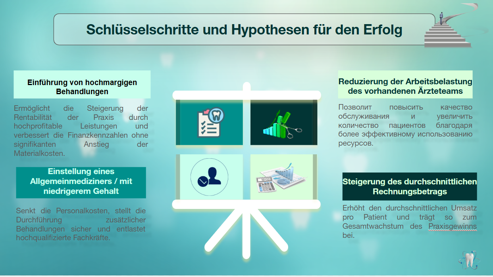
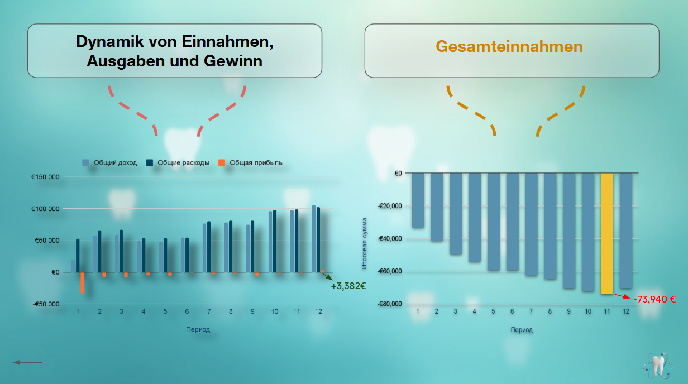
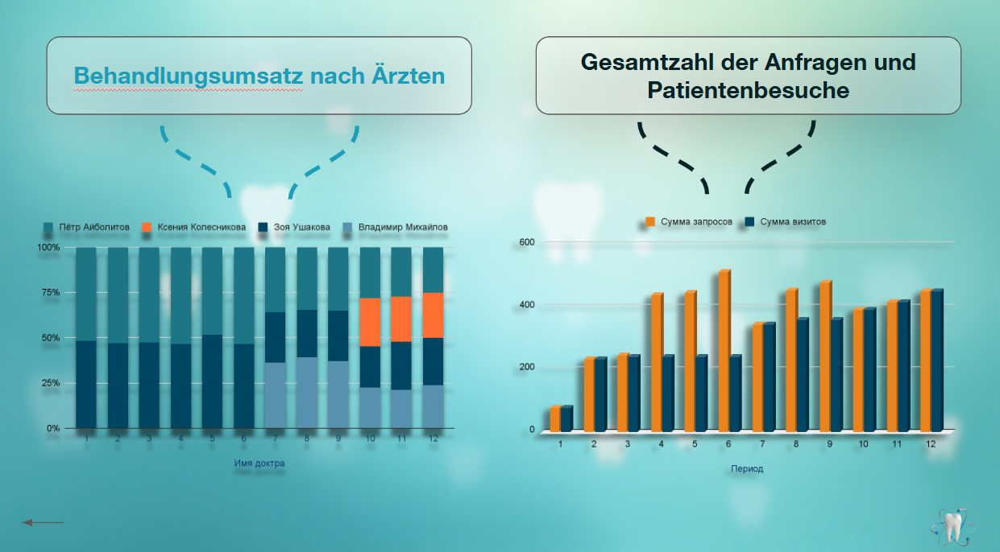
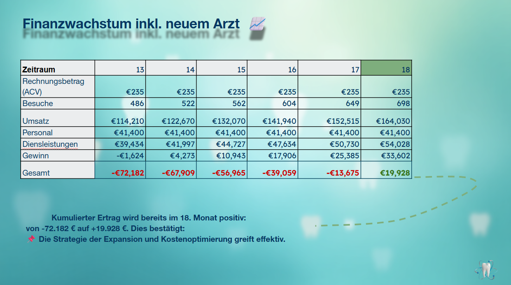

# Mint Dental Care: Financial Analysis & Growth Strategy 🏥📊

An end-to-end financial analysis, operational bottleneck evaluation, and strategic growth forecast for **Mint Dental Care** clinic.

---

## 📊 Executive Summary & Key Findings

This project analyzes the annual operational and financial performance of a dental practice, identifying capacity limits and modeling strategic growth hypotheses.

### Key Insights:
1. **Financial Recovery & Profitability:**
   - **Periods 1–5:** Initial operational losses reaching a peak cumulative deficit of **–€73,940**.
   - **Period 6 Onward:** Capacity stabilization through team expansion. First profitable month achieved in **Period 12 (€3,382)**.
2. **Capacity & Operational Bottlenecks:**
   - High demand at the end of quarters led to staff overload (initially only 2 doctors), causing lost patient inquiries and uncaptured revenue.
   - Expanding the team to 4 doctors stabilized workload distribution and increased total handled visits.
3. **Price Satisfaction Survey:**
   - **24%** of patients are fully satisfied with current pricing.
   - **69%** accept current prices.
   - Only **7%** expressed dissatisfaction.

---

## 🖼 Key Project Slides

### 1. Key Steps & Growth Hypotheses

### 2. Financial Dynamics & Overview

### 3. Doctor Workload & Patient Inquiries

### 4. Financial Growth & Projections

---

## 🚀 Strategic Growth Hypotheses & Modeling

To achieve cumulative profitability, two key initiatives were modeled for Periods 13–18:

1. **Hiring a General Practitioner (Cost Optimization):**
   - Hiring a lower-cost general doctor frees up senior specialists, lowers overall payroll overhead, and increases appointment throughput.
   - **Result:** Cumulative returns turn positive by **Month 18 (+€19,928)**.

2. **High-Margin Services & Pricing Adjustment (+10% Average Check / ACV):**
   - Introducing high-margin procedures and adjusting prices (ACV increased from €235 to €259).
   - **Result:** Monthly profit reaches **€50,354** by Period 18, generating a total cumulative return of **+€104,432**.

---

## 🛠 Project Structure

---

## 📈 Methodology & Tools Used
- **Financial Modeling:** Revenue/Cost structure decomposition, break-even analysis, cumulative margin calculations.
- **Capacity Planning:** Demand vs. Utilization tracking per doctor.
- **Presentation & Storytelling:** Executive-level data visualization and scenario modeling.
